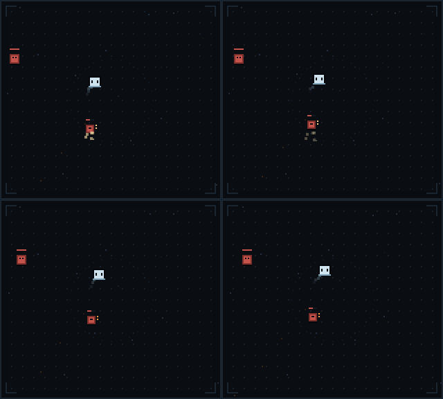

# 🐾 DSH Pet

> 住在 DeepSeek Harness 右侧栏、用会话输出 token 驱动的像素自动战斗小游戏。

<p align="center">
  
</p>

你干活，它打怪。每消耗 500 个 output token，战场就多刷一只怪；每 3000 个 token 来一波「过载潮」。

这一版把旧的卡牌、属性、核心与敌人锁整体替换成了**组件化技能系统**：技能由 `动作 + 属性 + 修饰` 组装，不同技能通过灼烧、寒冷、充能三种共享状态和战场位置触发传火、导电、碎裂。架构升级进一步加入了**战斗风格、动作生命周期、持续实体、独立移动策略**：挥斩、飞弹、光环、冲击、弧光飞剑、御剑、陷阱共用同一套命中、属性、反应与统计。角色成长另有一套**基础属性 → 战斗属性**换算：升级自由加力量 / 敏捷 / 智力 / 体魄，折算成护甲、通用伤害、攻击速度与暴击。这一版再把「按层刷怪」换成**99 层随机地图**：每局重新生成分叉路线，普通 / 精英 / 休息 / 事件 / 商店六种节点，生命与金币跨节点保留，可以手动规划也可以交给稳健 / 均衡 / 冒险三档自动路线。技术设计见 [skill-architecture.md](docs/skill-architecture.md)，目标玩法见 [skill-system-complete-design.md](docs/skill-system-complete-design.md)，升级方案见 [combat-style-architecture-upgrade.md](docs/combat-style-architecture-upgrade.md)，剑修专项见 [sword-cultivator-skill-design.md](docs/sword-cultivator-skill-design.md)，角色属性见 [character-attributes-design.md](docs/character-attributes-design.md)，地图见 [map-system-design.md](docs/map-system-design.md) 与 [map-system-implementation.md](docs/map-system-implementation.md)。

## 亮点

- **99 层随机地图**：每局用主种子重新生成分层有向图，第 1 层普通战斗、第 98 层休息、第 99 层最终 Boss；完成当前节点后只能沿连线进入下一层，可以分叉、汇合、再分叉。
- **逐路线保底**：休息 / 商店间隔按**每条有效路线**验证（而不是只看某一层），前 3 层无精英、精英不连续、同层不全精英；生成失败时退化为确定性模板。
- **一个种子一张图**：结构、类型与节点内容各走独立随机流，节点内容种子只跟主种子与节点 ID 有关，走过的路线不会改变其他节点的敌人、事件与商品。
- **生命与金币跨节点保留**：战斗胜利后剩余生命写回地图，商店、事件与休息点在同一套资源上取舍。
- **手动规划 + 自动挂机**：手动模式每个分叉都停下；稳健 / 均衡 / 冒险三档自动路线会看未来 3 层，低生命且没有休息点、或事件没有安全选项时自动暂停并说明原因。
- **组合而不是背卡表**：同一个火焰属性装到飞弹、光环、挥斩、弧光飞剑或御剑上，沿用同一套命中规则。
- **共享状态产生连锁**：多个技能一起叠灼烧 / 寒冷 / 充能，再由战场规则触发反应；`引爆`修饰可以把一个技能铺好的状态转成另一个技能的范围爆发。
- **多种战斗风格**：远程射手、近战斗士、剑修、陷阱师只改变起始动作与移动偏好，不复制结算代码。
- **可自由分配的成长**：每升一级 +1 属性点，力量 / 敏捷 / 智力 / 体魄按固定换算折成护甲、伤害、攻速与暴击；升级界面直接显示「护甲 6 → 8」这类投入后变化。
- **动作与实体分层**：动作只负责检查与施放，飞弹、弧光飞剑、飞剑、剑阵、陷阱走统一实体生命周期；命中仍由公共结算处理。
- **独立移动决策**：接近 / 保持距离 / 自动三种策略统一决定站位，技能通过 `preferredRange` 提供建议。
- **可预测的代价**：扩大牺牲频率，分裂只对远程首个命中生效，牵引只对范围技能有效。
- **确定性模拟**：固定 60Hz 步长、显式 RNG、FIFO 命令队列；相同 seed 与输入得到相同结果。
- **纯本地**：只读 DSH 的会话统计，不额外调用模型；进度存在 `localStorage`。
- **一局一存档，三槽可切换**：打开面板先进入存档大厅，可继续最近存档、开新游戏、读取或删除任意槽位；打开面板本身不会写盘。
- **一个工作区一只宠物**：同一 `cwd` 下的会话共享角色和存档。

## 技能结构

```text
技能 = 动作 + 属性 + 修饰
```

动作单独存在时就是可用技能；属性与修饰槽可以为空。一局最多两个技能，每个技能三个槽位；备用栏最多三个组件。

### 动作

| 动作 | 基础行为 | 原型数值 |
|---|---|---|
| **挥斩** | 朝近处目标挥出扇形，命中扇区内有限敌人 | 1.1 秒冷却，3 伤害，30 范围，110°，至多 3 个目标，带 `heavy` |
| **飞弹** | 朝射程内最近的敌人发射弹体 | 0.9 秒冷却，2 伤害，104 射程 |
| **光环** | 周期性影响宠物附近的敌人 | 1.1 秒冷却，1 伤害，30 范围，至多 3 个目标 |
| **冲击** | 在敌群中心引爆一次范围效果，带 `heavy` | 3 秒冷却，5 伤害，24 范围，至多 8 个目标 |
| **弧光飞剑** | 从角色侧后方划出弧线追击最近敌人，末段有限追踪，单目标，可被路径上的其他敌人拦截 | 1.2 秒冷却，2 伤害，104 索敌，78 推荐距离，至多 3 柄同时存在 |
| **御剑** | 召唤飞剑环绕自身，接触敌人时造成伤害 | 3.2 秒冷却，2 伤害，12 环绕半径，7 秒，同目标 0.55 秒间隔 |
| **飞剑穿敌** | 朝目标方向放出穿透飞剑，沿途命中有限敌人 | 2.4 秒冷却，3 伤害，120 射程，至多 3 次命中 |
| **剑阵** | 在目标位置布下固定区域，周期性伤害 | 8 秒冷却，2 伤害，36 范围，5 秒，0.8 秒一跳，至多 4 个目标 |
| **陷阱** | 在最近敌人脚下布置陷阱，敌人靠近时引爆 | 4.5 秒冷却，4 伤害，64 布置射程，20 爆炸范围，20 触发范围，9 秒 |

### 属性

| 属性 | 命中效果 | 共享状态 |
|---|---|---|
| **火焰** | 施加灼烧 | 灼烧：每 1.5 秒按层数损失生命，最多 5 层，持续 6 秒 |
| **冰霜** | 施加寒冷 | 寒冷：每层降低 8% 移速，最多 5 层 / 40% |
| **雷电** | 额外 +1 伤害，施加充能 | 充能：最多 3 层，持续 8 秒，可被下一次雷电命中消耗 |

### 修饰

| 修饰 | 效果 | 能力要求 |
|---|---|---|
| **分裂** | 首次命中后，对附近至多 2 个目标造成 50% 伤害 | 需要 `ranged`（飞弹 / 冲击） |
| **回响** | 0.7 秒后再次造成 50% 伤害 | 需要 `hit`（所有动作） |
| **扩大** | 范围 ×1.45，冷却 ×1.25 | 需要 `area`（光环 / 冲击 / 挥斩 / 陷阱 / 剑阵） |
| **牵引** | 命中时把敌人向效果中心拉近 16px | 需要 `area`（光环 / 冲击 / 挥斩 / 陷阱 / 剑阵） |
| **引爆** | 消耗目标全部状态，在目标处造成每层 2 点范围伤害，冷却 ×1.2 | 需要 `hit`（所有动作） |

不兼容的组合会在编译期返回结构化错误，升级界面不会提供无意义的选择。

### 共享反应

| 反应 | 条件 | 结果与终止条件 |
|---|---|---|
| **传火** | 带灼烧的敌人被击败 | 40 范围内至多 2 个敌人各继承 50% 层数；可以跨死亡连续传播，受传播深度 4、目标数、层数与命令预算约束 |
| **导电** | 带充能的敌人再次受到雷电命中 | 消耗充能，44 范围内至多 3 个目标各受 3 伤害；雷击不施加充能，也不能再导电 |
| **碎裂** | 寒冷 ≥3 的敌人受到 `heavy` 命中 | 消耗全部寒冷，28 范围内至多 4 个目标各受 3 伤害；碎裂伤害没有 `heavy`，不能再碎裂 |

每个反应都有显式的范围、目标数、数值和终止条件；连锁不会靠递归副作用自行结束。反应按 `priority`、再按稳定 ID 排序，同一事件对同一反应至多触发一次。致死命中仍完成本次状态与反应检查：火焰致死可传火、雷电致死可导电、强力致死可碎裂。

### build 示例

- **野火流**：飞弹 + 火焰 + 分裂；光环 + 火焰 + 扩大。远处点燃多个目标，近处持续叠灼烧，用传火处理密集敌群。
- **雷暴流**：飞弹 + 雷电 + 回响；光环 + 雷电 + 扩大。多个攻击来源反复积累并消耗充能，频繁触发导电。
- **冰爆流**：光环 + 冰霜 + 牵引；冲击 + 冰霜 + 回响。先减速聚集，再用带 `heavy` 的冲击触发碎裂。
- **霜刃斗士**：挥斩 + 冰霜 + 扩大；光环 + 冰霜 + 牵引。光环聚怪，挥斩叠寒冷并以强力命中触发碎裂。
- **霜弧剑阵**：弧光飞剑 + 冰霜；剑阵 + 雷电。中距离弧线持续叠寒冷，剑阵在固定区域铺充能并触发导电。
- **穿敌剑阵**：飞剑穿敌 + 火焰；剑阵 + 冰霜 + 回响。直线飞剑覆盖远处，剑阵固定区域持续叠寒冷并触发碎裂。
- **焚天剑修**：御剑 + 火焰 + 回响；冲击 + 冰霜 + 牵引。飞剑多次接触点燃敌人，击败后传火。
- **环身剑阵**：御剑 + 冰霜；剑阵 + 火焰。以贴身风险换取环剑持续接触，剑阵负责区域覆盖。
- **陷阱雷区**：陷阱 + 雷电 + 扩大；飞弹 + 雷电 + 分裂。飞弹先铺充能，敌人踩入陷阱后触发导电。

## 战斗风格与移动

风格只提供起始动作、默认移动偏好与视觉主题，不拥有独立结算代码。风格在「新游戏」界面选择，切换等同重开本轮；解锁条件使用累计最高层数。

| 风格 | 起始动作 | 默认移动 | 解锁 |
|---|---|---|---|
| **远程射手** | 飞弹 | 保持距离 | 初始 |
| **近战斗士** | 挥斩 | 接近 | 初始 |
| **剑修** | 弧光飞剑（后续可获得飞剑穿敌、剑阵、环身御剑） | 保持距离 | 最高层达到 3 |
| **陷阱师** | 陷阱 | 保持距离 | 最高层达到 5 |

移动策略跟随风格默认值（接近 / 保持距离 / 自动），战场面板不再显示移动栏；需要临时改策略可用 `setMovement` 调试接口。

- **接近**：偏向进入近战技能有效范围。
- **保持距离**：优先利用远程技能射程。
- **自动**：按已装备动作的 `preferredRange` 折中选择站位。

技能不直接争夺移动控制；`movement.js` 每步统一决定站位。突进等位移内容尚未接入，但位移请求层已实现优先级、来源 ID、边界与失败丢弃的确定性裁决。

## 角色属性

角色有四项基础属性，初始都是 0；**每升一级 +1 点**，可以在面板的「属性」行自由投入任意一项，不占用技能三选一的名额。四项属性对全部战斗风格使用同一份换算。属性行默认折叠成一行（显示可用点数与护甲 / 暴击摘要），点标题才展开四项属性与加点按钮；构筑行同样默认折叠，展开后显示技能槽位与备用栏。

| 基础属性 | 每点效果 | 定位 |
|---|---|---|
| **力量** | 护甲 +2 | 稳定减伤 |
| **敏捷** | 攻击速度 +1%，暴击率 +0.5 个百分点 | 攻击频率与暴击 |
| **智力** | 通用伤害加成 +2% | 所有技能与反应的输出 |
| **体魄** | 最大生命 +1 | 承受伤害 |

战斗属性 = 基础值 + 属性点换算 + 装备词条（装备系统未实现，先留接入点）。基础值：最大生命 24、护甲 0、通用伤害 0%、攻击速度 0%、暴击率 5%、暴击伤害 50%。上限：护甲减伤 60%、攻击速度 100%、暴击率 100%。

```text
最终伤害 = 基础伤害 × (1 + 通用伤害加成 + 满足条件的伤害加成) × 暴击倍率
护甲减伤 = min(60%, 护甲 / (护甲 + 100))
实际冷却 = 基础冷却 / (1 + 攻击速度)
```

- 每条伤害命令都标注了伤害通道：`direct`（技能直接命中）与 `derived`（分裂 / 回响 / 引爆）可以暴击，`dot`（灼烧跳伤）与 `reaction`（导电、碎裂）不暴击；每个独立命中单独判定暴击。
- 分裂与回响从「未应用角色属性的基础伤害」出发各自结算，不会把通用加成重复叠加。
- 暴击使用独立的显式 RNG 流（`battle.combatRng`，由同一 seed 派生），所以加入暴击不会改变刷怪位置与三选一候选。
- 内部伤害保留小数，界面显示时再取整，小幅成长不会被每次命中取整吃掉。
- 属性在命中结算时读取当前战斗属性；已经飞出去的实体与延迟命令不额外快照，加点后立刻生效。
- 数值只影响「打多疼」和「挨多疼」，不改变冷却阶段的实体内部计时（灼烧跳伤间隔、飞剑接触间隔）。

## 地图系统

一局是一张 99 层的分层有向图：节点是地点，连线是可行路线。第 1 层固定普通战斗，第 2–97 层每层 3–5 个节点，第 98 层固定休息点，第 99 层固定最终 Boss。完成当前节点后才能沿连线进入下一层，不能跳层或横向移动。

| 地点 | 图标 | 进入与奖励 |
|---|---|---|
| 普通怪物 | ⚔ | 稳定成长：胜利后获得金币与经验 |
| 精英怪物 | ◆ | 末位敌人强化、数量略少；胜利金币更多并补一次三选一 |
| 休息点 | ☾ | 二选一：恢复 30% 最大生命，或获得一次三选一；满血时可安全离开 |
| 事件点 | ? | 选项写明代价与结果，付不起的置灰；事件不会直接把玩家扣死 |
| 商店 | $ | 治疗 / 技能组件 / 属性点，可以只看不买，同件只能买一次 |
| 最终怪物 | ☠ | 第 99 层：8 只敌人 + 强化 Boss，击败补两次三选一 |

生成规则（详见 [map-system-implementation.md](docs/map-system-implementation.md)）：

- **种子**：每局一个主种子，派生拓扑 / 类型 / 锚点 / 节点内容四条独立随机流；节点内容种子只跟主种子与节点 ID 有关。
- **锚点层**：休息与商店整排同类型，层间距抖动（休息 7–10 层、商店 8–11 层），保证「每条有效路线的任意连续 12 层至少一个休息点、18 层至少一个商店」。
- **修正与验证**：前 3 层无精英、精英不连续、同层不全精英、没有死路；修正后仍不通过就换重试种子，超过上限使用同样经过验证的确定性保底模板。
- **生命与金币跨节点保留**：战斗从地图当前生命开始，胜利后剩余生命写回；新游戏才重置本局资源并重新生成地图。
- **失败重试**：保留当前节点与本局构筑，补一次三选一后重试，不重复发放节点奖励；连续失败 3 次暂停自动重试，点「重试当前节点」继续。
- **自动路线**：手动 / 稳健 / 均衡 / 冒险。自动模式会看未来 3 层的连线，低生命且下一站没有休息点、或事件没有无代价选项时暂停并说明原因。
- **存档**：地图、当前位置、已走路线、事件选择、商店售出与奖励领取状态都写进存档（第 7 版），读档不会重复获取；同种子在相同版本与配置下生成同一张图。

## 一局中的成长

1. 开局按选中的风格给一个基础动作，让玩家先理解攻击节奏。
2. 每次升级同时获得 1 个属性点；每两级额外获得一次技能三选一，两者各自完成、互不竞争。
3. 第一次技能三选一只提供属性，让玩家看到命中效果变化。
4. 之后开放修饰，改变技能行为。
5. 第三个阶段开放第二个动作，让两个技能共享状态。
6. 槽位装满后，升级提供替换选择；被换下的组件进入备用栏，点击备用栏组件可以装回空槽。
7. 两个技能槽都满后，升级候选仍可能提供新动作：新动作会替换一个现有动作，保留兼容组件，旧动作与不兼容组件进入备用栏；空间不足时不会强行装入。
8. 风格在「新游戏」界面选择；战场面板不再显示风格栏与移动栏，移动策略使用所选风格的默认值。

升级时提供三选一，候选可以混合动作、属性和修饰；每张候选显示**装入后的完整描述**。有多个可装位置时让玩家选择槽位，只有一个合理位置时直接装入。每两级获得一次选择，阵亡会停在原层重试并补一次选择；阵亡重试保留本轮已分配与未分配的属性点，通关重开或切换风格会重置本轮成长。

## 战斗与模拟

- 玩家基础 24 格生命（体魄每点 +1），护甲按 `护甲 / (护甲 + 100)` 减伤，上限 60%；伤害内部保留小数，界面取整显示。
- 每次固定步的顺序：状态计时 → 刷怪与常规移动 → 技能施放 → 位移裁决 → 实体推进与碰撞 → 延迟命令 → 按 FIFO 处理命中与后续命令 → 死亡与反应 → 敌人攻击 → 胜负检查。
- 动作生命周期：`canCast` 无副作用；`cast` 成功才启动冷却与施放计数，失败时保持就绪，下一固定步重试。飞弹、弧光飞剑、御剑、陷阱通过实体层推进，不直接改敌人生命或状态。冷却按攻击速度折算。
- 命中结算：校验目标 → 按伤害通道折算通用/条件加成与暴击 → 扣除有效伤害（溢出单独统计）→ 属性状态（致死命中仍完成本次施加）→ 修饰阶段命令 → 共享反应 → 死亡统一结算。
- 每个命令携带 `eventId`、`rootEventId`、深度与技能归因；派生命令继承根事件。命令深度上限 8，每根事件最多 96 条命令，每步最多 1600 条；超限写入诊断，不静默随机丢弃。
- 编辑构筑会重新编译；已经生成的弹体 / 弧光飞剑 / 飞剑 / 剑阵 / 陷阱保留创建时的技能计划快照，新施放使用新计划。

### 敌人

| 敌人 | 行为 | 提出的问题 |
|---|---|---|
| **群游者** | 数量多、生命低，直线靠近 | 能否处理密集目标？ |
| **重甲兽** | 移速慢、生命高、接触伤害高 | 能否集中输出或持续牵制？ |
| **游击者** | 保持约 52 距离并发射弹体 | 能否覆盖远处和移动目标？ |

敌人不读取具体技能 ID，只通过统一的伤害、状态、移动和死亡接口参与战斗。

### 层数与压力

- 地图节点决定战斗构成：普通节点 8–16 只敌人，精英节点数量减少但末位强化，Boss 节点为 8 只敌人 + 强化 Boss；45 秒内没清完判超时。
- 敌人体力与伤害按层成长；第 16 层起数量平滑延伸到 16 只上限，生命成长曲线放缓、伤害在第 30 / 55 / 80 层各 +1，避免深层变成纯数值墙。
- 每 500 output token 额外刷 1 只怪，每场最多 +18；超出部分丢弃。
- 每 3000 token 尝试触发一次「过载潮」：立刻 +6 只怪；清场后额外给一次三选一。
- 通关第 99 层后重开一轮并生成新地图，构筑回到所选风格的起始动作。
- 旧的 15 层表（`src/game/floors.js`）仍然保留：测试、平衡模拟与预览脚本用它按固定层数开战。

### 失败与诊断

阵亡或超时后停在当前节点重试，保留构筑与备用栏，并补一次升级选择；节点奖励不会重复发放。结算面板显示：

1. 结果：阵亡 / 超时 / 清层。
2. 原因：生命耗尽，或 45 秒内输出不够。
3. 伤害构成：本场伤害前三的技能占比。
4. 反应与修饰统计：传火 / 导电 / 碎裂，以及引爆等修饰触发次数。
5. 下一站（清场时）或重试说明（阵亡时）。

## 安装

DSH Pet 是一个 DSH **插件 bundle**（宿主插件 + 浏览器侧 UI），未发布到 npm，需要从 GitHub 或本地路径安装。

### 前置条件

- 已安装 **DSH Desktop**（推荐），或 DSH CLI + `pnpm`。
- Node.js 20+ 仅在本地开发/跑测试时需要；安装插件本身不需要。

### 方式 A：插件管理器（推荐）

在 DSH 的插件管理里安装 bundle，来源填：

- GitHub：`github:jianghckx-droid/dsh-pet`
- 本地开发：`link:D:/myProject/my-dsh-pet`（换成你的绝对路径）

插件管理器会把 `dsh-pet` 追加到 profile 的 `dsh.profile.bundles`。安装完成后**完全退出并重启 DSH**。

### 方式 B：命令行（非 desktop profile）

> `desktop` profile 由 DSH Desktop 持有，请使用方式 A。下面的命令适用于 `web`、`tui` 等自建 profile。

```sh
dsh plugin --profile web add github:jianghckx-droid/dsh-pet
```

`dsh plugin` 只是转发给 pnpm，**不会**自动修改 bundles 列表。还需要编辑 `$DSH_HOME/profiles/web/package.json`，把 `dsh-pet` 追加到 `dsh.profile.bundles` 数组末尾（保留你已有的条目）：

```json
{
  "dependencies": {
    "dsh-pet": "github:jianghckx-droid/dsh-pet"
  },
  "dsh": {
    "profile": {
      "bundles": ["@deepseek-ai/dsh-base", "@deepseek-ai/dsh-web-app", "dsh-pet"]
    }
  }
}
```

然后重启 DSH。

### 本地开发安装

```sh
git clone https://github.com/jianghckx-droid/dsh-pet.git
dsh plugin --profile web add link:/absolute/path/to/dsh-pet
```

Windows 路径示例：`link:D:/myProject/my-dsh-pet`。同样需要把 `dsh-pet` 加进 `dsh.profile.bundles`。

### 首次打开

1. 打开任意一个会话（右栏只在有会话时存在）。
2. 点输入框右侧的 **🐾** 按钮，或在右栏打开「宠物」tab。
3. 第一次打开会停在存档大厅：没有存档时点「开始游戏」，选择槽位与战斗风格；有存档时点「继续游戏」或「新游戏」。
4. 开始后才会创建/更新存档，并开始统计 token 增量；之前的历史 token 不会一次性倒进战场。

## 操作一览

| 操作 | 怎么做 |
|---|---|
| 打开面板 | 输入框右侧 🐾 / 右栏「宠物」tab |
| 展开 / 收起地图 | 点「地图」标题行；折叠时显示当前节点与下一站，展开后按层列出节点 |
| 选择下一站 | 分叉时点画布上方的「下一站」按钮，或展开地图后点绿色节点 |
| 查看节点说明 | 展开地图后点任意节点方块；再点一次关闭说明 |
| 看完整地图 | 展开地图后点「查看完整地图」，列表可滚动 |
| 切换自动路线 | 展开地图后点「手动 / 稳健 / 均衡 / 冒险」 |
| 休息点 | 在画布面板里选「恢复生命」「构筑强化」或「安全离开」 |
| 事件 / 商店 | 事件选项与商品都写明代价与结果；付不起的置灰，商店可随时离开 |
| 打开存档菜单 | 顶部「存档」按钮；打开后战斗冻结 |
| 继续游戏 | 大厅点「继续游戏」，读取当前/最近槽位 |
| 新游戏 | 大厅点「新游戏」，选择槽位与起始风格 |
| 读取其他槽位 | 槽位卡片点「读取」，从该存档所在层开始 |
| 删除存档 | 槽位卡片点「删除」，再点「确认删除」 |
| 立即保存 | 暂停菜单点「保存进度」；进层 / 升级 / 结算也会自动保存 |
| 开发者调试 | 存档大厅底部的「开发者模式」开关；开启后全部风格可选，关闭后恢复原门槛 |
| 选择升级 | 升级后点三选一中的一张；多槽位时再点一次装入位置 |
| 展开 / 收起属性 | 点「属性」标题行；折叠时显示可用点数与护甲 / 暴击摘要，展开后才有加点按钮 |
| 展开 / 收起构筑 | 点「构筑」标题行；折叠时只显示技能数与备用数，展开后显示技能槽位、描述与备用栏 |
| 分配属性点 | 展开「属性」后点对应属性的 `+1`；右侧显示投入后的实际变化（如「护甲 6 → 8」），没有点数时按钮不可点 |
| 替换组件 | 槽位已满时，升级候选会给出「替换」位置 |
| 替换动作 | 两个技能槽已满后，动作候选会给出「动作槽（替换）」位置 |
| 装回备用栏 | 展开构筑后，点备用栏 chip |
| 切换风格 | 面板不再显示风格栏；在「新游戏」界面选择风格，等于重开本轮，未解锁风格不可点 |
| 切换移动策略 | 面板不再显示移动栏；跟随风格默认值 |
| 重试 | 失败结算后自动重试当前节点；连续失败 3 次会暂停，点「重试当前节点」继续 |
| 看状态 | 顶部：层数（当前 / 总层）/ 等级 / 最佳层 / 金币 / 修饰符 / 技能数 / 存档；地图行：当前节点与下一站；折叠行：属性（可用点数 + 护甲 / 暴击）、构筑（技能数 / 备用数）；底部：生命 / 击杀 / 敌数 / 压力 / token |

切 tab、折叠右栏不会中断模拟（tab 使用 `keepMounted`）。关闭整个 DSH 后停止。

### 开发者调试

存档大厅底部有「开发者模式」开关。开启后，剑修、陷阱师等未解锁风格在游戏内风格栏和新游戏界面都可以直接选择，风格栏会显示 `DEV` 标记；关闭后立即恢复原解锁门槛。

开关保存在 `dsh.pet.debug`，是**本机全局**设置：不写入存档，不修改累计战绩或最佳层，只放宽 UI 的风格选择限制。

## 数据与隐私

- 宿主只提供同源接口 `GET /dsh-pet/usage`，返回各会话的 token、工具调用数、忙碌时长与运行状态。
- 客户端只读取这些已有统计，**不会发起额外的模型请求**。
- 每个工作区有 3 个存档槽位：槽位 1 使用 `dsh.pet.v5.<workspaceKey>`（即旧版 v5 键），槽位 2/3 追加 `.slot2` / `.slot3`；当前自动保存目标记录在 `.active`。`workspaceKey` 来自会话的 `cwd`（Windows 下转小写）。
- 打开面板本身不写盘；只有开始新游戏、继续游戏或手动保存后才创建/更新存档。自动保存发生在进入地图节点、战斗结算、升级与失败重开时。
- v5 存档键位不变，内容是第 7 版数据：战斗风格、移动策略、技能构筑（技能实例 ID、槽位、备用栏）、当前层、等级 / 经验、待选升级数、四项基础属性、未分配属性点、累计战绩（击杀、最高层、单层击杀、抽卡数）、**地图（节点、连线、当前位置、已走路线、事件选择、商店售出、金币与生命、自动模式）** 与保存时间。
- 地图不只手存种子：算法或权重更新后同一颗种子会产生不同地图，所以节点与已生成内容一起保存；`mapVersion` 不符或结构损坏时按存档层数重新生成一张地图并提示。
- 没有属性字段的旧存档按「已投入 0 点、每升一级 1 点」推算未分配点数：旧档没有花过点，所以这是还原而不是补发；属性点一旦投入本轮不可撤回。
- 读档时先迁移版本、校验组件 ID，再重新编译。缺失或已移除的组件会被安全清空，并在面板顶部显示提示，而不是让整份存档无法加载；修复 v5 前会把原存档备份到对应槽位键的 `.bak`。
- 没有 v5 时读取 v4：构筑与进度原样保留，补默认风格 / 移动策略、并按等级补齐属性点后写入槽位 1；v4 原档不删除。旧 `v3` 存档只迁移累计战绩；旧卡牌、属性与核心**不会**硬映射成新组件，迁移后会显示提示。
- 「继续游戏」读取当前/最近槽位；读取其他槽位会从该存档所在层重新开始，并把自动保存切到该槽位。
- 读取与「新游戏」都会把当前与目标槽位的累计战绩按最大值合并，避免旧档让风格解锁回退。「新游戏」只重置本轮（层数、等级、经验、待选升级与构筑）。
- 删除当前槽位会放弃本轮并回到大厅。删除槽位 1 时会一并清理该工作区的 v4/v3 旧版源档，避免旧档在删除后又“复活”。
- 开发者模式开关保存在 `dsh.pet.debug`（本机全局，不带工作区），只放宽 UI 的风格选择门槛，**不写入存档、不修改累计战绩**；关闭后立即恢复原解锁规则。
- 刷新页面后回到存档大厅；点「继续游戏」后从存档记录的当前节点重新开始。飞行中的弹体、冷却等战斗实例状态不保存；地图节点、金币与生命会保存。

## 架构

```text
战斗风格 styles（起始构筑 / 移动偏好 / 视觉主题）
                  ↓
内容定义 actions / elements / modifiers / statuses / reactions / styles
                  ↓ 注册并校验
构筑 build → 编译 compiler → 不可变技能计划 SkillPlan
                                ↓
战斗模拟 world → 调度 runtime → 动作处理器 → 效果结算 resolver
                  ↑                 ↓              ↓
                RNG/时钟      实体 entities   状态/反应/命令队列
                  ↑                 ↓              ↓
              移动决策 movement  碰撞/生命周期   战斗事件与统计
                                                    ↓
                                            UI / 回放 / 模拟器
```

```text
DSH session/event
      │
      ▼
 index.js（宿主）── 折叠 token / 工具调用 / running / cwd
      │
      ▼
 GET /dsh-pet/usage（同源 JSON）
      │
      ▼
 client.js（右栏 UI）── 800ms 轮询 → token 增量 → 压力 / 过载潮
      │                                   │
      │  构建时内联                         ▼
      └──────────────► src/game/ ──► arena 战斗世界（60fps 固定步长）
```

| 部分 | 文件 | 职责 |
|---|---|---|
| 宿主 | [`index.js`](index.js) | 监听 `session/event`，按 `cwd` 归并工作区，提供 usage 接口 |
| 客户端 | [`client.js`](client.js) | 注册右栏 tab 与 🐾 按钮，轮询 token，跑存档大厅、战斗循环、绘制与升级 UI |
| 战斗世界 | [`src/game/arena.js`](src/game/arena.js) | 位置、刷怪、敌人 AI、经验、属性点、三选一与胜负编排 |
| 角色属性 | [`src/game/attributes.js`](src/game/attributes.js) | 基础属性换算、战斗属性、伤害 / 减伤 / 冷却公式与升级预览 |
| 移动决策 | [`src/game/movement.js`](src/game/movement.js) | approach / keepDistance / auto 与位移请求裁决 |
| 静态契约 | [`src/game/skills/schema.js`](src/game/skills/schema.js) | 能力、效果类型、移动策略、构筑与运行时上限 |
| 内容注册 | [`src/game/skills/registry.js`](src/game/skills/registry.js) + [`content/`](src/game/skills/content/) | 动作 / 属性 / 修饰 / 状态 / 反应 / 风格定义与校验 |
| 编译 | [`src/game/skills/compile.js`](src/game/skills/compile.js) | 构筑校验、不可变 `SkillPlan`、结构化描述与存档修复 |
| 动作 | [`src/game/skills/actions/`](src/game/skills/actions/) | 契约校验、描述、`canCast` / `cast` 与实现表 |
| 修饰 | [`src/game/skills/modifiers/index.js`](src/game/skills/modifiers/index.js) | compile / onHit 阶段处理器与描述 |
| 实体 | [`src/game/skills/entities/`](src/game/skills/entities/) | 飞弹、弧光飞剑、飞剑、剑阵、陷阱生命周期、碰撞与清理 |
| 世界接口 | [`src/game/skills/world.js`](src/game/skills/world.js) | 目标查询、生成实体、提交命中、表现事件 |
| 状态与反应 | [`status.js`](src/game/skills/status.js) / [`reactions.js`](src/game/skills/reactions.js) | 层数、计时、共享反应命令 |
| 结算 | [`src/game/skills/resolve.js`](src/game/skills/resolve.js) | 命中快照、有效伤害、命令队列、死亡反应 |
| 调度 | [`src/game/skills/runtime.js`](src/game/skills/runtime.js) | 技能冷却、成功计数与处理器分派 |
| 构筑编辑 | [`src/game/skills/draft.js`](src/game/skills/draft.js) | 放置规则、原子替换、备用栏、三选一 |
| 风格 | [`src/game/skills/styles.js`](src/game/skills/styles.js) | 风格读取、解锁、起始构筑 |
| 敌人与层 | [`src/game/enemies.js`](src/game/enemies.js) / [`floors.js`](src/game/floors.js) | 敌人行为、15 层表与第 16–99 层的深层构成 |
| 地图随机数 | [`src/game/map/rng.js`](src/game/map/rng.js) | 哈希派生与 mulberry32，显式种子、可复现 |
| 地图配置 | [`src/game/map/config.js`](src/game/map/config.js) | 地点类型、权重、锚点间距、保底间隔与 11 层原型配置 |
| 地图结构 | [`src/game/map/topology.js`](src/game/map/topology.js) | 分层有向图、比例映射连线与覆盖补边 |
| 地图类型 | [`src/game/map/types.js`](src/game/map/types.js) | 固定层 / 锚点层 / 权重抽取与迭代修正 |
| 地图验证 | [`src/game/map/validate.js`](src/game/map/validate.js) | 结构、可达性、逐路线保底（状态集合传播） |
| 地图内容 | [`src/game/map/content.js`](src/game/map/content.js) | 节点战斗构成、事件选项、商店货架与金币 |
| 地图生成 | [`src/game/map/generate.js`](src/game/map/generate.js) | 尝试 → 修正 → 验证 → 确定性保底模板 |
| 地图进度 | [`src/game/map/run.js`](src/game/map/run.js) | 本局状态、节点结算、自动路线与地图存档 |
| 构建 | [`tools/build-client.mjs`](tools/build-client.mjs) | 把规则核心内联进 `client.js` 的 `// <core>` 区域 |

**为什么要内联**：DSH 客户端插件使用单文件 loader（`window.__ModuleLoader__.load({ factory(require) })`），第三方插件没有打包器，不能 `import` 本地相对路径。所以核心以 ESM 维护，构建时生成 `client.js` 里的纯声明副本。**不要手改 `client.js` 的 `// <core>` 到 `// </core>` 区块**，它会被下一次构建覆盖。

`src/game/` 同时被游戏、单测与两个无头模拟器使用，保证「设计用的数字」和「跑起来的游戏」不会各算各的。

## 项目结构

```text
.
├── index.js                 # 宿主侧：会话信号折叠 + /dsh-pet/usage
├── client.js                # 浏览器侧：tab、按钮、canvas、升级 UI（含生成的核心）
├── cordis.patch.yml         # bundle 入口：把 dsh-pet 插入 profile
├── package.json             # bundle 元数据 + npm scripts
├── icon.svg                 # 插件图标
├── locale/                  # 插件标题与描述（zh / en）
├── src/game/
│   ├── arena.js             # 战斗步骤、敌人、经验、属性点、三选一与胜负编排
│   ├── attributes.js        # 基础属性 → 战斗属性、伤害 / 减伤 / 冷却公式
│   ├── movement.js          # 接近 / 保持距离 / 自动与位移请求裁决
│   ├── enemies.js           # 群游者 / 重甲兽 / 游击者
│   ├── floors.js            # 15 层表、层修饰符、第 16–99 层深层构成
│   ├── map/
│   │   ├── rng.js           # 哈希派生 + mulberry32 随机流
│   │   ├── config.js        # 地点类型、权重、锚点间距与原型配置
│   │   ├── topology.js      # 分层有向图与连线
│   │   ├── types.js         # 类型分配与保底修正
│   │   ├── validate.js      # 结构 / 可达性 / 逐路线保底验证
│   │   ├── content.js       # 战斗构成、事件、商店与金币
│   │   ├── generate.js      # 生成流程与确定性保底模板
│   │   └── run.js           # 本局进度、自动路线与地图存档
│   └── skills/
│       ├── constants.js     # 场地尺寸等共享常量
│       ├── format.js        # 数值格式化
│       ├── schema.js        # 静态契约与运行上限
│       ├── registry.js      # 内容注册与跨引用校验
│       ├── compile.js       # build → SkillPlan + 结构化描述 + 存档修复
│       ├── status.js        # 灼烧 / 寒冷 / 充能实例
│       ├── reactions.js     # 传火 / 导电 / 碎裂
│       ├── resolve.js       # 命中结算与命令队列
│       ├── world.js         # 动作 / 实体可用的受限世界接口
│       ├── runtime.js       # 技能冷却与动作调度
│       ├── draft.js         # 槽位、原子替换、备用栏、三选一
│       ├── styles.js        # 风格读取、解锁与起始构筑
│       ├── actions/         # 契约 + 挥斩 / 飞弹 / 光环 / 冲击 / 弧光飞剑 / 御剑 / 飞剑穿敌 / 剑阵 / 陷阱
│       ├── entities/        # 生命周期 + 飞弹 / 弧光飞剑 / 飞剑 / 剑阵 / 陷阱
│       ├── modifiers/       # 修饰 compile / onHit 处理器
│       └── content/         # 动作 / 属性 / 修饰 / 状态 / 反应 / 风格数据
├── tools/
│   ├── build-client.mjs     # 核心内联（--check 校验）
│   ├── run-tests.mjs        # 单进程测试运行器
│   ├── balance-sim.mjs      # 解析 DPS 与层数压力
│   ├── arena-report.mjs     # 固定种子的真实空间模拟报告
│   ├── synergy-report.mjs   # 跨技能配合与反应观察
│   ├── map-report.mjs       # 批量生成地图：成功率、类型分布、路线间隔与金币收支
│   └── render-frame.mjs     # 离屏渲染 PNG，用来肉眼检查画面
├── test/                    # node:test 单测
└── docs/                    # 设计文档与预览图
```

## 开发

要求 Node.js 20+。项目没有运行时依赖，克隆后即可跑。

```bash
npm test            # 单进程加载全部测试（受限环境也能跑）
npm run test:node   # 原生 node --test（适合完整权限环境）
npm run build       # 修改 src/game/ 后重新内联到 client.js
npm run build:check # 校验 client.js 是否与 src 同步（提交前跑）
npm run sim         # 解析 DPS：技能形状、层数压力、修饰取舍
npm run arena       # 固定 seed 跑全部 15 层、多套 build 的真实模拟
npm run synergy     # 跨技能配合与反应的结构性观察
npm run map         # 批量生成 99 层地图：成功率、类型分布、路线保底与金币收支
npm run map:proto   # 同一份报告，跑 11 层原型配置
npm run preview     # 离屏渲染一帧到 docs/preview.png
```

约定：

- 改 `src/game/` 后必须 `npm run build`，并把生成的 `client.js` 一起提交。
- 新内容优先通过注册定义接入：新属性声明 `requires` 与 `onHit`，新状态放进 `content/statuses.js`，不要为「火焰飞弹」「火焰御剑」分别写组合分支。
- 新动作需要动作契约（`actions/contracts.js`）+ 运行时处理器（`actions/*.js`）+ 内容定义；新实体需要 `entities/` 处理器。处理器表与内容校验共用同一来源，未知处理器会在启动或编译时失败。
- 新修饰在 `modifiers/index.js` 声明 compile / onHit 阶段与描述；结算器不按修饰类型写分支。
- 所有伤害与状态施加都在 `resolve.js` 的命中结算里；`arena.js` 不直接改敌人生命，动作/实体只通过 `world.js` 接口提交命令。
- 数值平衡改完后跑 `npm run sim` 和 `npm run arena`，再手动看一次 `npm run preview`。
- 改地图生成（权重、锚点、间隔、内容池）后跑 `npm run map`，并确认 `test/map.test.mjs` 仍然全绿；生成规则变化要同时提升 `MAP_VERSION`，否则同一种子会悄悄换图。

## 设计文档

| 文档 | 内容 |
|---|---|
| [skill-architecture.md](docs/skill-architecture.md) | 技能系统技术架构、动作/实体/移动/结算、实现落点 |
| [character-attributes-design.md](docs/character-attributes-design.md) | 基础属性与战斗属性、伤害 / 减伤 / 冷却公式、升级加点与实现状态 |
| [skill-system-complete-design.md](docs/skill-system-complete-design.md) | 当前目标玩法 v1.1、风格、成长、敌人与验证 |
| [sword-cultivator-skill-design.md](docs/sword-cultivator-skill-design.md) | 剑修专项：弧光飞剑、中距离移动、组合契约与验收 |
| [combat-style-architecture-upgrade.md](docs/combat-style-architecture-upgrade.md) | 多战斗风格架构升级阶段、验收与实现状态 |
| [skill-system-improvement-review.md](docs/skill-system-improvement-review.md) | 设计评审、优先改进项与处理结果 |
| [skill-system-design.md](docs/skill-system-design.md) | 早期技能玩法设计，保留共享反应与敌人方向 |
| [map-system-design.md](docs/map-system-design.md) | 99 层地图玩法提案：节点类型、结构、保底、交互与界面 |
| [map-generation-design.md](docs/map-generation-design.md) | 随机地图生成方案：种子、数据结构、生成流程与验证 |
| [map-system-implementation.md](docs/map-system-implementation.md) | 地图实现说明：算法落点、锚点与保底、战斗衔接、存档与验证 |
| [design.md](docs/design.md) | 旧产品设计（属性 / 卡牌 / 核心 / 锁），仅作历史记录 |
| [cards.md](docs/cards.md) | 旧卡表，已被技能组件取代 |
| [mechanics.md](docs/mechanics.md) | 旧六家族机制扩展，已被修饰与反应取代 |
| [floors.md](docs/floors.md) | 旧层数表与「第 6 层墙」，已被新层数表取代 |

## 状态与已知限制

这是技能系统、多战斗风格与 99 层地图的**可玩原型**，不是完整游戏。

已接通：

- 9 个动作（挥斩 / 飞弹 / 光环 / 冲击 / 弧光飞剑 / 御剑 / 飞剑穿敌 / 剑阵 / 陷阱）、3 个属性、5 个修饰、3 种共享状态、3 个共享反应
- 4 项基础属性（力量 / 敏捷 / 智力 / 体魄）、每级 1 点自由分配、升级预览、护甲减伤、攻击速度折算冷却、逐命中暴击与条件伤害接入点
- 4 个战斗风格、3 种移动策略、风格解锁与起始构筑
- 动作生命周期、持续实体（飞弹 / 弧光飞剑 / 飞剑 / 剑阵 / 陷阱）、修饰阶段处理器、统一世界接口
- 构筑编译与结构化错误、能力校验、空槽、原子替换、动作替换与 3 格备用栏
- 升级三选一与阶段开放（属性 → 修饰 → 第二个动作）、多槽位选择、折叠式属性点面板（四个属性 + 投入后变化）与折叠式构筑面板
- 引爆修饰与跨技能状态消耗；`npm run synergy` 提供结构性配合观察
- 99 层随机地图：分层有向图、六种地点、固定层、逐路线保底、确定性保底模板与 `npm run map` 批量检查
- 地图进度：生命 / 金币跨节点、休息点二选一、事件代价、商店购买与重复购买保护、节点奖励只发一次
- 自动路线：手动 / 稳健 / 均衡 / 冒险，前瞻 3 层，低生命或事件无安全选项时暂停并说明原因
- 地图存档（第 7 版）：节点、路线、当前位置、事件选择、商店售出、金币与生命；旧档按所在层补生成
- 3 种敌人、层修饰符、精英 / Boss 战斗构成、token 压力与过载潮
- 固定步长确定性模拟、命令 / 实体上限与诊断、暴击独立 RNG 流
- 存档迁移（v4→v5、v3 战绩）、失效组件安全清空提示、属性点存档与旧档按等级推算
- 3 槽位存档大厅、继续游戏 / 新游戏、读取与删除、手动保存
- 开发者调试模式：本机开关，开启后可选全部战斗风格
- 折叠式地图栏 / 属性栏 / 构筑栏（默认各占一行，点击展开）、伤害构成与反应次数报告、实体绘制

尚未接通 / 已知缺口：

- 99 层还没有分段、主题与分段内容池；整张图共用一套敌人与事件，深层主要靠数量与数值成长。
- 跨局永久成长未接入：只有风格解锁沿用「最高层数」条件，永久属性 / 核心成长没有实现。
- 地图事件没有「安全选项」标记字段，自动路线用「无代价」近似判断，需要设计确认更明确的标记。
- 地图金币与商店价格只做了粗略校准（`npm run map` 给出收支估算），还没有整局供需模拟。
- 工作信号（token 压力 / 过载潮）只作用于当前战斗，与地图推进、刷怪压力的关系仍待设计。
- 设计稿里的召唤、突进、聚焦与第三个技能尚未实现。
- 装备系统未实现：护甲、通用伤害、攻击速度、暴击率、暴击伤害与条件伤害都已经有接入点（`bonuses`），但还没有槽位、获取与词条生成规则；条件伤害目前只由测试构造。
- 属性点一旦投入本轮不可撤回；是否提供重置留待后续决定。
- 战场面板不再提供风格 / 移动切换：风格在「新游戏」界面选择，移动策略跟随风格默认值；`setStyle` / `setMovement` 仍作为调试接口保留。
- 弧光飞剑首版只做单目标；万剑齐发、弧剑分裂等仍在候选，未实现。
- 每个技能最多一个属性 + 一个修饰；不支持同一技能叠多个修饰。引爆已作为通用修饰接入，但更多消耗 / 触发类互动仍需试玩验证。
- 完整动作 × 属性 × 修饰兼容矩阵、召唤所有权与危险位移评估仍待补。
- 没有图鉴、进化、多语言、设置页、音效；升级不能重抽。
- 数值与层数曲线仍是原型参数，需要真实试玩校准。
- 预览图渲染的是一个固定示例 build 的单帧，不覆盖所有动作 / 属性 / 修饰组合。

## 贡献

欢迎 Issue 和 PR。提交前请至少跑：

```bash
npm test
npm run build:check
```

如果改动涉及规则或数值，请同步更新 `docs/`，并在 PR 里说明对哪些层、哪些 build 的影响。

## 致谢

灵感来自吸血鬼幸存者式的自动战斗、roguelike 的构筑，以及「挂机游戏不该惩罚用户努力工作」这个念头。为 DeepSeek Harness 而写。

---

<p align="center">
  <sub>DSH Pet · <a href="https://github.com/jianghckx-droid/dsh-pet">GitHub</a></sub>
</p>
